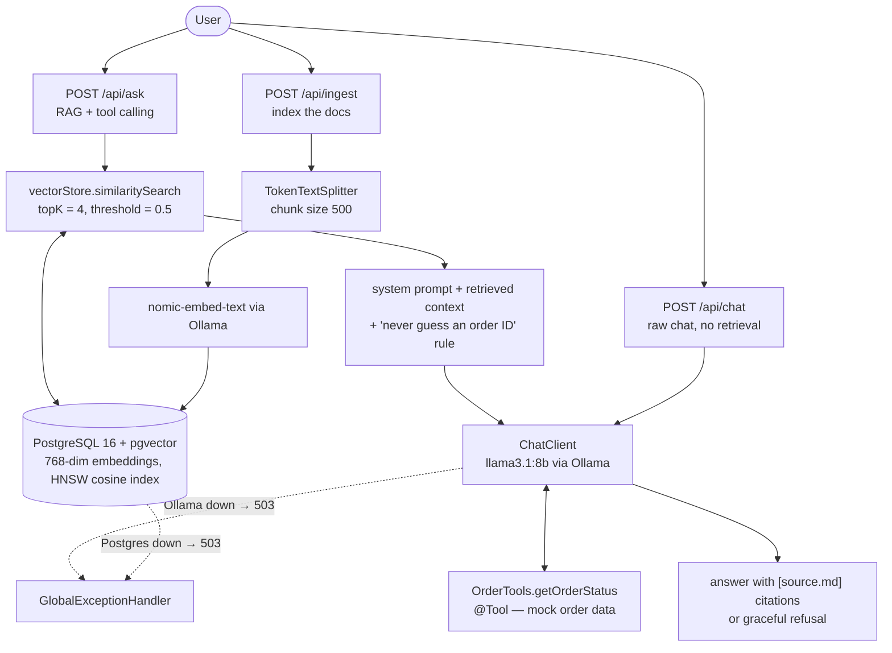

# BrightCart Support Chatbot

A customer-support chatbot for a fictional e-commerce store ("BrightCart"), built with **Spring AI 2.0**
on **Spring Boot 4.1.1 (Java 21)**. It answers support questions with **retrieval-augmented generation
over pgvector** — every answer grounded in the store's own policy docs, cited inline, with a **refusal
path** when the docs don't contain the answer — and **calls tools** to look up order status. Runs
**fully local** via Ollama and Postgres + pgvector. No paid LLM APIs.

## What it does

- **Grounded RAG answers** — the question is embedded (`nomic-embed-text`), the top-4 chunks are
  retrieved from pgvector (cosine similarity, threshold 0.5), and the answer is composed *only* from
  that context. Nothing relevant retrieved → the bot says it doesn't know instead of hallucinating.
- **Inline citations** — answers cite the source doc, e.g. `[return-policy.md]`, so every claim is auditable.
- **Tool calling** — order questions invoke a typed `@Tool` (`OrderTools.getOrderStatus`) backed by mock
  order data; the model routes between documents and the tool. Ask about an order without an ID and it
  asks you for the ID instead of guessing — a real bug found and fixed during testing.
- **Graceful degradation** — Ollama down → `503`; Postgres down → `503`; blank question → `400`.
  No stack traces leak to clients.
- **100% local** — chat (`llama3.1:8b`) and embeddings run on Ollama; nothing leaves the machine.

## Architecture



Design notes:

- Retrieval is done manually via `similaritySearch` rather than Spring AI's `QuestionAnswerAdvisor` —
  deliberately. The manual path keeps the retrieved `Document` objects in hand, which is what makes
  citations trivial to return.
- The API tier is **stateless**: no session state, no conversation memory. It scales horizontally behind
  a load balancer; the LLM is the bottleneck, not the app.

## Evaluation

`eval/eval_run.py` fires a 10-question regression set at `POST /api/ask`, times each call, and saves raw
responses for human judging:

| Category         | Example                          | Expected                                  |
|------------------|----------------------------------|-------------------------------------------|
| Doc-grounded (5) | "What is your return policy?"    | Correct answer + `[return-policy.md]` cite |
| Known order (2)  | "Where is order BC-1001?"        | Tool result: SHIPPED + tracking number    |
| Unknown order (1)| "Where is order BC-9999?"        | Graceful not-found, nothing invented      |
| Missing ID (1)   | "Where is my order?"             | Asks for the ID — never guesses one       |
| Off-topic (1)    | "Capital of France?"             | Refusal, offers human support             |

**Results: 10/10 pass.** p50 latency **~7.1s** on a local `llama3.1:8b` (first-call model warmup ~18s;
short answers ~1s). Honest local-inference numbers — no GPU, no paid API.

## Tech stack

| Layer        | Choice                                                        |
|--------------|---------------------------------------------------------------|
| Language     | Java 21                                                       |
| Framework    | Spring Boot 4.1.1, Spring AI 2.0                              |
| LLM (local)  | Ollama — `llama3.1:8b` (chat), `nomic-embed-text` (embeddings) |
| Vector store | PostgreSQL 16 + pgvector (768-dim, HNSW cosine index)         |
| Build / test | Maven, JUnit 5 + AssertJ + MockMvc                            |
| Infra        | Docker Compose (Postgres)                                     |

## Run it locally

Prerequisites: Java 21, Maven, Docker, and the Ollama macOS app.

```bash
# 1. Start Postgres + pgvector
docker compose up -d

# 2. Pull the models (one time, several GB)
ollama pull llama3.1:8b
ollama pull nomic-embed-text

# 3. Run the app
mvn spring-boot:run

# 4. Index the 15 BrightCart support docs (one time)
curl -X POST localhost:8080/api/ingest
# -> {"chunksStored":15}
```

## Try it

```bash
# RAG: grounded, cited answer from the policy docs
curl -s localhost:8080/api/ask -H 'Content-Type: application/json' \
  -d '{"question":"What is your return policy?"}'

# Tool: order lookup (BC-1001 shipped, BC-1002 processing, BC-1003 delivered)
curl -s localhost:8080/api/ask -H 'Content-Type: application/json' \
  -d '{"question":"Where is my order BC-1001?"}'

# Guardrail: no ID -> asks for it instead of guessing
curl -s localhost:8080/api/ask -H 'Content-Type: application/json' \
  -d '{"question":"Where is my order?"}'

# Refusal: off-topic -> declines gracefully
curl -s localhost:8080/api/ask -H 'Content-Type: application/json' \
  -d '{"question":"What is the capital of France?"}'

# Raw chat: no retrieval, for comparison
curl -s localhost:8080/api/chat -H 'Content-Type: application/json' \
  -d '{"question":"Write a haiku about e-commerce."}'
```

An IntelliJ-runnable `requests.http` with these calls (plus the 400/503 cases) lives in the repo root.

## Project layout

```
src/main/java/com/support/chatbot/
  ChatController.java          # /api/ask (RAG + tools), /api/chat (raw), /api/ingest
  DocIngestion.java            # chunk + embed + store the support docs
  OrderTools.java              # @Tool getOrderStatus (mock order data)
  GlobalExceptionHandler.java  # 503/400/500 mapping (+ ErrorResponse)
src/main/resources/docs/       # 15 BrightCart support docs (the knowledge base)
eval/eval_run.py               # 10-question regression harness
requests.http                  # runnable sample requests (IntelliJ)
```

## Roadmap

- **Phase 2:** Dockerize the app, Kafka analytics pipeline (chat-interaction events off the request
  path), GitHub Actions CI, Angular chat UI
- **Phase 3:** Redis semantic cache, rate limiting on `/api/ask`, k6 load test with published numbers

## Why this project

Built to learn Spring AI 2.0 end to end: RAG pipelines, chunking strategy, citation and refusal design,
LLM tool calling, eval methodology — and the unglamorous parts (error handling, tests, docs) that make
a demo shippable.

